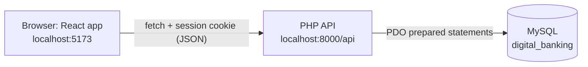
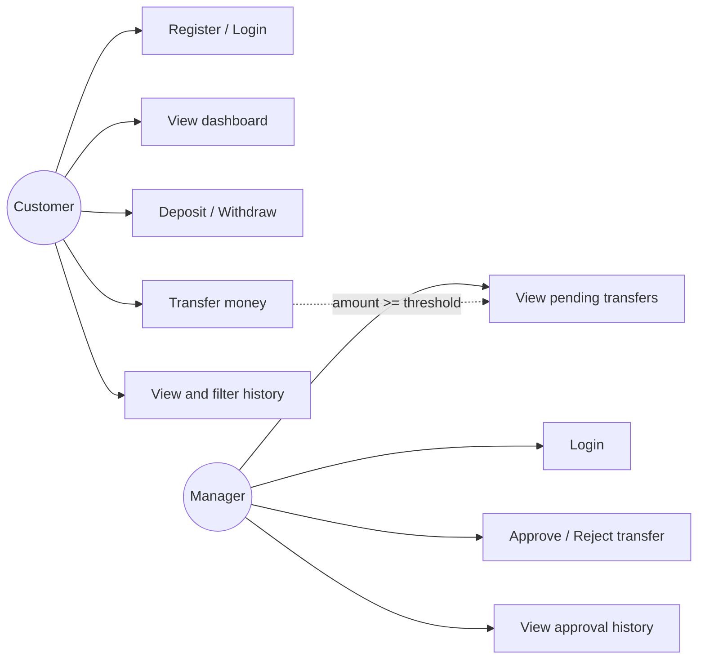
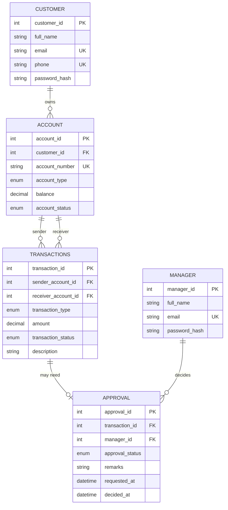
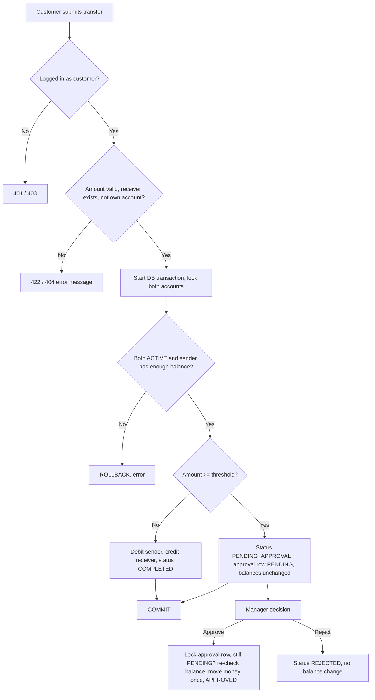

# Digital Banking Platform – Smart Transaction Management

**A Microproject Report** (Integrated MCA)

| | |
|---|---|
| Student name | ______________________ |
| Roll number | ______________________ |
| Guide | ______________________ |
| Institution / Year | ______________________ |

---

## 1. Introduction

Digital banking lets people check balances and move money from a phone or computer. Banks protect customers with
strict rules: money must never be created or lost, a customer must only see their own account, and unusually large
payments should be checked by a person. This project builds a small **simulated** banking web application that
demonstrates those ideas. It uses fake money and demo data only and is not connected to any real bank.

## 2. Problem statement

Manual or poorly designed transaction systems can show wrong balances, allow overdrafts, process the same request
twice, or let large transfers go through without any review. The problem is to design a web application where
customers can manage simulated accounts safely, balances always stay consistent, and **high-value transfers are
held until a manager approves them**.

## 3. Objectives

1. Provide secure registration and login for customers, and a separate login for managers.
2. Let customers view their account and make deposits, withdrawals and transfers.
3. Validate every amount, balance, account and owner on the server.
4. Keep balances consistent using database transactions and row locking.
5. Hold transfers of ₹1,00,000 or more (configurable) as *pending* until a manager approves or rejects them, and make sure a request can be approved only once.
6. Show a clear transaction history with type, status, date, and debit/credit direction.
7. Provide a simple, responsive, readable user interface.

## 4. Scope and requirements

**Functional requirements**

- FR1 Register, log in, log out (customer); log in/out (manager).
- FR2 Customer dashboard (name, account number, balance, status, recent transactions).
- FR3 Deposit, withdraw, transfer between accounts.
- FR4 High-value transfer → pending approval; balances unchanged until approved.
- FR5 Manager views pending requests, approves or rejects with remarks, views history.
- FR6 Transaction history with search and filters.

**Non-functional requirements**

- Security: hashed passwords, prepared statements, session login, server-side role checks.
- Reliability: all-or-nothing money updates (transactions + rollback).
- Usability: responsive layout, clear messages, loading and empty states.
- Maintainability: small files, one API file per action, comments for beginners.

## 5. Technology stack

| Layer | Technology |
|---|---|
| Frontend | React 18 (JavaScript) with Vite, React Router, CSS |
| Backend | PHP 8.2, PDO (prepared statements), REST-style JSON API |
| Database | MySQL 8 (InnoDB) |
| Tools | Windows, VS Code, XAMPP PHP, MySQL Workbench, Git/GitHub |

## 6. System architecture

- React shows pages and sends requests; it never decides balances or roles.
- PHP checks the session, role, input and business rules, and is the only code that changes money.
- MySQL stores data and also enforces rules (`balance >= 0`, `amount > 0`, valid transaction shape).

## 7. Modules

| Module | What it does | Files |
|---|---|---|
| Authentication | Register, login, logout, session, role checks | `register.php`, `login.php`, `manager_login.php`, `logout.php`, `me.php`, `helpers/auth.php` |
| Account & dashboard | Show account details and recent transactions | `dashboard.php` |
| Deposit / Withdrawal | Change one account balance safely | `deposit.php`, `withdraw.php` |
| Transfer | Validate, move money or create a pending request | `transfer.php` |
| Transaction history | Filter and search | `transactions.php`, `helpers/transactions_helper.php` |
| Approval (manager) | List, approve, reject, history | `approvals_pending.php`, `approval_decide.php`, `approvals_history.php` |
| Frontend | Pages, routing, protected routes | `frontend/src/...` |

## 8. Use cases

## 9. Database design

Tables: `customer`, `manager`, `account`, `transactions`, `approval`, `app_settings`.

**How pending transfers and approvals work**

| Situation | `transactions.transaction_status` | `approval.approval_status` | Balances |
|---|---|---|---|
| Normal transfer | COMPLETED | (no approval row) | changed immediately |
| High-value transfer requested | PENDING_APPROVAL | PENDING | **not changed** |
| Manager approves | COMPLETED | APPROVED | sender −, receiver + (once) |
| Manager rejects | REJECTED | REJECTED | **not changed** |

**Constraints:** primary keys and foreign keys on every relationship; UNIQUE on email, phone, account number and
`approval.transaction_id` (one approval per transaction); `CHECK (balance >= 0)`, `CHECK (amount > 0)`; a CHECK that
a deposit has no sender, a withdrawal has no receiver, and a transfer has two different accounts; a CHECK that a
PENDING approval has no manager/decision date while a decided one has both. Money columns use `DECIMAL(15,2)`.

**Normalization (to 3NF):** every column holds one atomic value (1NF); every table has a single-column key, so no
partial dependency (2NF); customer details live only in `customer` and account details only in `account`,
transactions refer to accounts by ID and approvals refer to transactions by ID, so non-key columns depend only on
the key (3NF). The threshold lives in `app_settings` instead of being repeated or hard-coded.

## 10. Workflow of a transfer

**Concurrency and duplicates.** `SELECT ... FOR UPDATE` locks account rows during a money operation, so two
simultaneous withdrawals cannot both use the same balance. Accounts are always locked in ascending ID order to avoid
deadlocks. Approval locks the `approval` row and continues only if it is still PENDING, so a repeated or parallel
approval gets HTTP 409.

## 11. Security measures

- Passwords hashed with `password_hash()` and checked with `password_verify()`; never stored or logged in plain text.
- PDO prepared statements (real, not emulated) prevent SQL injection.
- Session cookie is `HttpOnly`, `SameSite=Lax`; the session ID is regenerated after login; idle sessions expire.
- Role and ownership are checked in PHP on every protected endpoint; the browser never supplies user IDs, balances or approval status.
- CORS allows only the configured frontend origins, with credentials.
- Errors are logged on the server; users see generic messages (no SQL errors, stack traces, or hashes).
- Hiding a button in React is only for convenience; PHP enforces authorization.

## 12. Testing

A full manual checklist (34 cases with input, expected and actual result columns) is in `docs/TESTING_CHECKLIST.md`.
It covers valid/invalid login, registration, deposit, withdrawal, normal transfer, high-value pending transfer,
approval, rejection, duplicate approval, insufficient funds, invalid receiver, role protection, logout and rollback.

## 13. Limitations

- Simulation only: no real banks, payment gateways, OTP or 2FA.
- One account per customer; no statements, email, or password reset.
- No login-attempt limiting and no HTTPS (local development setup).
- A single manager role; any manager can decide any request.
- No automated test suite; testing is manual.

## 14. Future enhancements

Multiple accounts per customer, scheduled and recurring transfers, OTP for approvals, audit log, PDF statements,
email notifications, admin panel for the threshold and users, HTTPS and rate limiting, automated tests.

## 15. Conclusion

The project demonstrates a complete three-tier web application: a React interface, a PHP REST-style API, and a
normalized MySQL database. It shows secure authentication, role-based authorization, atomic money movement with
locking, and a manager approval workflow for high-value transfers, while remaining small and understandable.

## Appendix: likely viva questions

1. **Why `DECIMAL` and not `FLOAT` for money?** Floats cannot represent many decimal values exactly (0.1 + 0.2 ≠ 0.3); DECIMAL is exact.
2. **What is a database transaction?** A group of SQL statements that either all succeed (COMMIT) or all are undone (ROLLBACK).
3. **Why `FOR UPDATE`?** It locks the row so another request cannot read-and-change the same balance at the same time.
4. **How do you stop approving twice?** Lock the approval row, continue only if status is PENDING, then change it; the second request sees it is no longer PENDING and gets 409.
5. **How is SQL injection prevented?** Prepared statements keep user input separate from the SQL text.
6. **Why hash passwords?** So a leaked database does not reveal passwords; hashing is one-way and salted.
7. **How do you stop a customer using manager APIs?** Each manager endpoint calls `require_role('manager')` which checks the server-side session.
8. **What is CORS?** A browser rule; the PHP server lists the React origin as allowed and permits cookies.
9. **Why are pending transfers not changing balances?** Money should move only after approval; otherwise a rejected transfer would need reversing.
10. **What normal form is the schema in?** Third normal form, because every non-key column depends only on its table's key.
